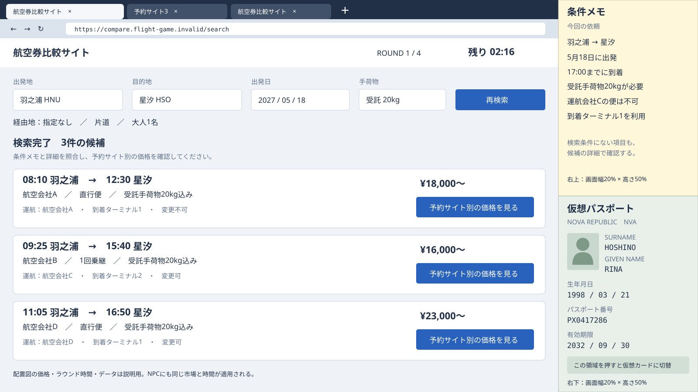
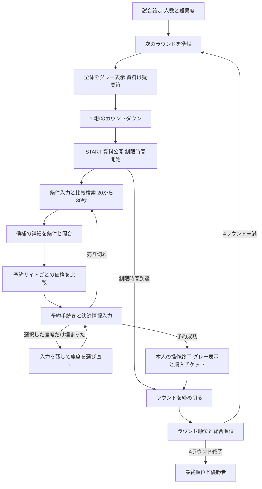

# 航空券予約対戦ゲーム 企画書

仮題：Flight Booker  最安予約グランプリ  
版：0.7  
作成日：2026年11月16日  
更新日：2026年11月17日  
状態：基本企画を整理済み 詳細ルールと調整値は検討中

架空のパスポートと条件メモを読み、架空の航空券比較サイト・予約サイトを使って、条件を満たす航空券をできるだけ安く予約する対戦ゲーム。複数サイトを並行して調べながら、安さ、売り切れ、座席確保、価格変動を判断する。4ラウンドの合計金額で優勝者を決める。

この企画書では、ユーザーが指定・採用した内容を「基本仕様」、追加したルールや数値を「仮案」、確認が必要な内容を「要確認」と表記する。仮案の数値は試作・プレイテストで調整する。全サイト共通の座席在庫とサイトごとの確保タイミングを正式に採用する。実装はHTML・CSS・TypeScriptによるWebゲームとし、Unityは使用しない。

## 1 企画概要

| 項目 | 内容 |
| --- | --- |
| ジャンル | 情報照合・予約操作・価格判断を組み合わせた対戦ゲーム |
| プレイヤーの役割 | 渡された人物の旅行条件を満たす航空券を予約する担当者 |
| 競争の単位 | 1試合を4ラウンドで構成する |
| 基本の勝利条件 | 4ラウンド合計金額が最小。同額なら合計予約タイムが短い人が勝利。入力ミス・条件違反に対する減点と順位への反映方法は別途決める |
| 想定人数 | 合計10〜20人。初期版は人間1人とNPC。人数・価格帯ごとの枠数は調整対象 |
| 初期版の構成 | ローカルで人間1人＋NPC9人を基本とする仮案 |
| 将来の拡張 | 人間同士のオンライン対戦、予約サイトの追加 |
| 舞台 | 架空のPCと、そのブラウザ上で動く航空券関連サイト |
| 実行環境 | PCのWebブラウザ |
| 実装方針 | HTML・CSSで画面、TypeScriptでゲーム処理を構成。Unityは使用しない。UIライブラリ等は実装設計で選ぶ |
| データ | 人物、パスポート、カード、航空会社、空港、航空券、比較サイト、予約サイトはすべて架空 |
| 操作の仮案 | PCのマウスとキーボード。Tabでの項目移動を含む |
| 画面の仮案 | 横長16:9。1920×1080を基準に比率を維持する |
| 所要時間の仮案 | 1ラウンド180秒、開始カウント10秒、結果表示20秒。4ラウンドで約14分＋最終結果 |

「ゲーム」はラウンド単位、「試合」は4ラウンドの総称として、以降の説明で使い分ける。

## 2 このゲームで味わう面白さ

### 条件を読み切って安い便を見つける

検索欄に入れる条件と、検索結果の詳細で確認する条件を分ける。安い数字だけを見て選ぶと、運航会社や到着条件を見落とす。正しく調べる速さと、必要な確認を省かない判断が問われる。

### 安さと確実さを選ぶ

最安サイトは手続き中でも売り切れる。確保型サイトは高い代わりに一定フェーズで席を押さえられる。変動型サイトでは予約確定の瞬間まで価格を見極める。同じ便でも、どのサイトで進めるかが戦略になる。

### 並行作業と焦りを扱う

検索の20〜30秒を利用して別タブを開くか、入力に集中するかを選ぶ。比較サイトを再検索している間も他の参加者の手続きは進む。タブを増やせば選択肢は増えるが、古い価格や違う便を見間違える危険も増える。

### 4ラウンドで巻き返す

1回の安い予約で満足せず、合計金額を抑える必要がある。安定して取るか、大きな節約を狙うかを、その時点の総合成績に応じて変えられる。ラウンド順位と総合順位を毎回発表し、順位の上下を見せる。

## 3 画面構成

### 通常プレイ画面

画面全体を左右に分割する。左側80%は高さ100%の架空PC画面。右側20%は上下を半分ずつに分け、上半分を条件メモ、下半分をパスポート・カード表示に使う。

| 領域 | 横位置 | 縦位置 | 1920×1080での参考サイズ |
| --- | --- | --- | --- |
| 架空PC | 左端から幅80% | 上端から高さ100% | 1536×1080 |
| 条件メモ | 右端の幅20% | 上端から高さ50% | 384×540 |
| パスポート・カード | 右端の幅20% | 下半分の高さ50% | 384×540 |



上図は配置を確認するワイヤーフレーム。仮の空港名・人物・金額を記載している。完成時のアート、色、装飾を確定するものではない。

### 左側の架空PC

ブラウザにタブ列、戻る・進む等の操作、ゲーム内URL、サイトの内容を表示する。最初から比較サイトを1タブ開いておく。別タブで比較サイトや予約サイトを複数開ける。

ラウンド数と残り時間はPC領域内の共通バー等に常時表示する仮案とする。サイトを切り替えても残り時間を確認できる。右側資料の表示領域を削らない。

架空PC内のブラウザはゲーム用UIとして実装する想定。現実のWeb閲覧・検索・予約・決済とは接続しない。

### 右上の条件メモ

出発地、目的地、旅行日、手荷物、利用可能な便の条件等を表示する。ページやタブを切り替えても常時見える。

メモは初期版では一覧で読める分量に抑える。幅20%に収まらない長文を増やす場合のスクロール・拡大は要検討。細かい文字を探すこと自体を主な難しさにしない。

### 右下のパスポートとカード

初期表示は架空パスポート。表示領域を押すと架空カードに切り替わり、再度押すとパスポートに戻る。片方ずつ表示し、情報を切り替えながら予約入力を行う。

どちらを表示中か分かる見出しと切替案内を付ける。クリックによる表示切替で、左側で入力中の値は消えない。

## 4 1試合の流れ



複数タブの検索・手続きは並行して進行できる。図の売り切れ後の戻り先は基本の導線であり、別タブの新しい検索結果を使う操作もできる。

## 5 ラウンド開始時

1. 新しいパスポート、カード、条件メモ、候補便、市場在庫を用意する。
2. 画面全体に半透明のグレーを重ね、奥のPC画面が透けて見えるようにする。
3. パスポートと条件メモには内容を出さず、「？」のみを表示する。カードへの切替でも事前に情報を読めない。
4. 画面中央で「10、9、8、…、1」とカウントする。カウント中は操作を受け付けない。
5. カウント終了時に「START」を表示し、グレーを解除する。同時に資料を公開し、操作と制限時間を開始する。

**基本仕様：** 各ラウンドで全員に同じパスポートと条件メモを配る。次のラウンドでは、全員共通の別のパスポート・条件メモへ変更する。初期版ではカード情報も全員共通とする仮案。入力量と利用できる候補をそろえ、予約の上手さを比較する。

10秒のカウントは予約タイムに含めない。検索処理やNPCの操作もSTARTと同時に開始可能になる。

## 6 比較サイトの検索と候補選択

### 検索時に設定できる条件

比較サイトは1種類。初期版では以下の項目を想定する。

| 項目 | 操作の想定 |
| --- | --- |
| 出発地・目的地 | 架空の都市・空港から選択 |
| 経由地 | 指定なし、指定の経由地等を選択 |
| 搭乗日 | 日付を選択 |
| 片道・往復 | 初期版は片道を基本とする仮案。往復対応は拡張候補 |
| 受託手荷物 | なし、必要な重量区分を選択 |
| 人数 | 初期版では1人に固定する仮案 |

### 検索の20〜30秒

検索開始から完了まで20〜30秒程度かかる。調査中の進捗や「さらに安い候補を確認しています」等の変化を見せ、次第に良い買い方を調べている感覚を作る。候補の一覧は検索完了後に表示する。

検索中に別タブへ移動しても処理は進む。全参加者が同じ検索条件なら、基本の検索所要時間も同条件にそろえる仮案とする。通信環境等による実世界のランダムな待ち時間は勝負に持ち込まない。

検索結果は取得時点の情報であり、その価格での予約を保証しない。結果には取得時刻を付ける仮案。古い結果から進むほど売り切れ・価格差の可能性があることを、ゲーム内で分かるようにする。

### 検索で絞り込めない条件

安い候補から詳細を見て、メモに合うかを判断する。初期候補として次を用意する。

| メモの条件例 | 候補で確認する情報 | 初期版の扱い |
| --- | --- | --- |
| 航空会社Cの便は使わない | 航空会社名 | 絞り込み不可 |
| 実際に運航する会社がCの便は使わない | 販売会社と運航会社の違い | 慣れた後のラウンドで導入する仮案 |
| 17時までに到着したい | 到着時刻 | 詳細で確認する仮案 |
| 到着ターミナル1を使いたい | 到着ターミナル | 詳細で確認する仮案 |
| 自分で荷物を受け取る乗継は不可 | 乗継方式 | 拡張候補 |
| 予定変更が可能な航空券が必要 | 変更可否 | 拡張候補 |

航空会社等の指定項目は、初期版では意図的に検索フィルタに設けない。隠し条件にはせず、判定に必要な情報は必ずメモと候補詳細に表示する。

### 予約サイト別の価格一覧

行程を選ぶと、同じ行程・手荷物条件に対する各予約サイトの価格を一覧で表示する。価格と一緒にサイトごとの特徴を短く示し、そこから各予約サイトを開ける。

比較する金額は、条件に必要な手荷物・必須手数料を含む総額とする仮案。追加料金を判断させる遊びは、基本の比較が成立してから導入する。

## 7 予約サイトの3種類

サイト名は仮称。特徴は基本仕様、具体的な価格幅・確保位置・在庫配分は調整対象。

| サイト | 価格 | 在庫と価格確定 | 主な駆け引き |
| --- | --- | --- | --- |
| 予約サイト1 最安型 | 他サイトより安い | 最終予約成功までは席を確保しない。途中でその価格帯の上限人数に達すると売り切れ | 安さを狙って入力を急ぐ。売り切れ時は再検索の時間を失う |
| 予約サイト2 確保型 | 割高 | ある手続き段階を越えると座席確保 | 高くても確実さを取る。確保後に落ち着いて残りを入力できる |
| 予約サイト3 変動型 | アクセス人数に応じて大きく動く | 予約確定ボタンを押した瞬間の価格で確定 | 需要が落ちるのを待つか、今の価格を取るかを判断する |

### サイト1の売り切れ

手続き中の閲覧・入力だけでは在庫を保持しない。価格帯の枠が埋まった時点で、そのチケットを確定できなくなる。「このチケットは売り切れました」と表示し、比較サイトへの再検索導線を示す。

古いタブを更新するだけでは枠は増えない。他人が未購入の確保枠を解放した場合は、再び空席になることがある。購入済みの席は復活しない。他の開いているタブは残すが、在庫の存在しないチケットを予約できない。

**基本仕様：** 座席番号の選択を設ける場合、選んだ席だけが埋まり別の席が空いているなら、入力情報を保ったまま座席選択へ戻す。同じ便全体が満席、またはその価格での販売枠が尽きた場合は、その便・価格では予約できないと示し、他サイト・別便・再検索へ進ませる。

**仮案：** 「常に最安」は、同一行程・同一必要条件について、その時点で予約できるサイト同士を比べた関係とする。売り切れたサイト1の価格は、予約可能な最安値として扱わない。別行程同士では価格が異なる。

### サイト2の確保段階

**仮案：** 搭乗者情報の入力画面から「決済へ進む」を押した段階で、座席とその時点の総額を確保する。入力値の正誤はここでは判定せず、確保中であることを明示する。

確保後にサイト側の都合で値上げ・売り切れにはしない。ただし、ラウンドの締切までに予約を完了しなかった場合は未予約となる。誤入力や条件違反の判定は、席を確保できるかどうかとは分け、ラウンド終了時に行う。

**基本仕様：** 1人が何枠でも確保できる。同じサイト・別サイトを問わず、人数やサイト数に基づく個人の確保上限は設けない。確保するたびにそこまでの手続き・入力が必要であり、確保に使う時間と自分の予約を完了する時間の配分も戦略になる。保持時間に独立した短い制限は置かず、予約完了またはラウンド終了まで保持できる設計とする。

大量確保も作戦の一つとして認める。タブを複製するだけで新たな枠が確保されることはなく、追加の確保には個別の手続き・入力が必要。同じ確保操作の再送・二度押しを、別の確保として数えない。

### サイト3の人数と価格

**仮案：** 同じ行程のサイト3を開いている参加者数が増えると価格が上がり、減ると価格が下がる。NPCの閲覧・離脱も同じように人数へ反映する。需要の読み合いを作る。

人数はタブ数ではなく「その行程を1つ以上のタブで開いている参加者数」で数える。同じ人が10タブ開いても1人扱い。最後の該当タブを閉じる、別の予約を完了する、ラウンドが終了する等で人数から外す。バックグラウンドのタブも開いている間は人数に含める仮案。

価格は一定間隔で更新し、現在額と上昇・下落を分かりやすく表示する。サイト1を最安に保つため、同一行程ではサイト3の下限額をサイト1の有効価格より上に置く仮案。サイト3はサイト2より安い場合も、高い場合もある。

最終ボタンには「このボタンを押した時点の表示価格で予約が確定する」と明記する。ローカル初期版では入力を受け付けた時点の価格を一貫して適用する。オンライン版の価格保証・受信時刻の扱いは別途設計する。

### 在庫の共通ルール

同一ラウンドの市場は全参加者・全予約サイトで共有し、在庫はタブやサイトごとに独立して増えない。有効に確保されている分は他人へ二重販売しない。

**基本仕様：** ある参加者がいずれかのサイトで予約を完了した瞬間、その人がほかの手続きで確保していた未購入の枠をすべて解放する。予約を完了したチケットの席は、購入済み在庫として残し、解放しない。このルールはサイト2だけでなく、将来追加する確保機能のあるサイトにも適用する。ラウンド終了時には、残った未購入の確保枠を解放する。

**基本仕様：** 同じ便の物理的な座席は、全予約サイトで同じ在庫を参照する。サイトごとに変えるのは価格と確保タイミング。サイト2等が途中で確保した時点で、その席を全サイトで他人が取れない状態へ更新する。サイト1・3等の未確保の手続きは最終確定時に空席を再確認する。古い画面を見ている人がいても、確保・購入の判定は最新の共通在庫で一件ずつ行い、同じ席が二重に成立しないようにする。

### 在庫方式の比較と採用方針

全サイトの共通在庫と、サイトごとに異なる確保タイミングを組み合わせる。検討した3案との関係は次のとおり。

| 案 | 内容 | このゲームでの特徴 |
| --- | --- | --- |
| 1 サイトごとの確保タイミングで反映 | サイト1は最後まで未確保、サイト2は途中確保して他サイトへ反映 | サイトの性格に合う。確保時点と最終購入時点の両方で、共通在庫を参照する必要がある |
| 2 全サイトで座席在庫を共有 | 確保・購入・解放のたびに共通在庫を更新 | 採用。どのサイトの操作も同じ市場へ影響し、二重確保を防げる。案1の確保タイミングの違いと組み合わせる |
| 3 サイトごとに座席を分ける | サイトごとに販売できる席を割り当てる | 席の割当が重ならなければ二重確保は起こらないが、別サイトへ逃げれば買える展開が増え、サイト間の取り合いは弱まる。将来の特殊サイトとしては検討できる |

**採用する組み合わせは「案2の共通在庫＋案1のサイトごとの確保タイミング」。** 全サイトで在庫を共有しても、サイト1を開いた時点で席が確保されるわけではない。確保機能の有無・時点は各サイトのルールに従う。

座席の状態は「空席」「ある手続きが確保中」「購入済み」に分ける。確保中から購入済みへ変更する場合は、その確保を行った手続きに限る。予約が完了した人の他の確保枠は空席へ戻す。

**基本仕様：** サイト2で確保した席を、サイト1の安い価格へそのまま持ち替えることはできない。サイト2の確保はその手続き・価格にひも付ける。同じ便を他サイトで安く取り直すなら、自分で確保を解除してから競争に戻る。これにより、サイト2で先に確保してサイト1で確実に安く買うことが、常に最適な手順になるのを避ける。解除ボタンの配置とタブを閉じた際の扱いは詳細設計で決める。

また、物理的な座席数と「その最安料金で売れる上限数」は別に管理する。例えば共通の空席が12席、サイト1の最安料金の販売上限が4枚なら、サイト1で取れる条件は「共通の空席がある」「最安料金の枠が残っている」の両方。空席があっても安い料金だけ売り切れる場面を作れる。

**調整の仮案：** 最安料金の枠は参加人数の3〜4割を初期目安とする。条件を満たす便の総供給は全員が購入可能な量を用意するが、未購入枠の抱え込みによって一時的に買えなくなる展開は戦略として発生し得る。具体的な配分は試作で決める。

## 8 複数タブと予約の制約

- 比較サイトを複数タブで開き、違う条件で検索できる。
- 複数の予約サイトを開き、入力を並行して進められる。
- タブを切り替えても入力内容と検索の進行は維持する。
- 在庫・価格は共有市場に基づき、古いタブでの表示を根拠に予約可能としない。
- **1人が最終的に予約できるチケットは、1ラウンドにつき1件。**
- 最初の予約成功時に、その人の他タブの最終確定操作は無効にし、保持中の別枠を解放する。
- 同時に複数の確定操作が届いても、成功は1件に限る。

タブ数の固定上限は現時点で設けない。多数のタブを扱う表示方法や性能は試作で確認し、タブ上限によって確保数を実質的に制限するルールは勝手に追加しない。

## 9 人物情報と決済情報

### パスポートに表示する情報

姓、名、生年月日、国籍、パスポート番号、有効期限を初期候補とする。予約サイトの入力欄のラベルと照合できるようにする。各項目が何を指すか曖昧な省略は避ける。

### カードに表示する情報

カード名義、ゲーム用カード番号、有効期限、ゲーム用確認コードを初期候補とする。番号はゲーム専用データとして扱い、実在する決済サービスへ送信・照会しない。

### 入力操作

資料を読み、対応する予約欄へ入力する。Tabによる入力欄移動、入力済み情報の保持、明確なフォーカス表示を用意する。自動入力は初期版に設けない仮案。コピー・貼り付け対応は入力の難しさに影響するため要調整。

**基本仕様：** パスポート・カードと違う情報を入力しても、その場では正誤を知らせず予約を進められる。入力ミスも旅行条件違反も、ラウンド終了時に判明する。最終確定前に正しい値へ自動修正したり、資料との不一致をエラーで教えたりしない。

予約完了前なら、自分で見直して入力を修正できる。予約完了後は本人のプレイが終了するため、入力やチケットは変更できない。

入力ミス・条件違反は、その程度に応じて減点する。違反の分類、点数、重複時の扱い、金額と順位への反映方法は後で詰める。全違反を一律で未予約・最高値扱いにはしない。未入力欄や極端な形式不正までそのまま通すか等の細部も、減点設計とあわせて決める。

## 10 プレイヤーごとの予約終了画面

予約が成功した瞬間、そのプレイヤーの操作を終了する。予約タイムを記録し、全画面に開始時と同様の半透明グレーを重ねる。

中央に予約したチケットを表示し、**画面全体の右下に購入金額を大きく表示**する。右下資料の上に重なる終了用の表示であり、通常時の80%・20%分割とは別のオーバーレイとする。

チケットには便・経路、搭乗者、搭乗日、購入サイトを表示する。入力操作や別タブの予約はできない。ほかの参加者はラウンド締切までプレイを継続する。

**基本仕様：** この時点では入力ミス・条件違反の有無を表示せず、予約チケットと確定した購入額を表示する。誤りがあっても、その人の予約操作はここで終了する。ラウンド結果で初めて、入力の誤り・違反条件と、決定したルールに基づく減点を購入金額とは別に示す。

## 11 ラウンド締切と集計

### 時間制限

ラウンド開始から共通の制限時間を設ける。仮の初期値は180秒。残り時間を全員で共有し、締切以降は新しい予約を確定できない。

**基本仕様：** 締切まで予約できなかった人は、一律で最高値のチケットを購入した扱いにする。追加ペナルティの有無・額は未確定。

**仮案：** 最初の試作では追加ペナルティを0円とする。「ラウンド最高値」は、シナリオであらかじめ定義する有効チケットの総額上限とする。サイト3にも上限を設け、失敗額が締切直前の人数や、誰かが実際に購入した最高額によって変わらないようにする。

最高値・残り時間・失敗時の扱いは、ゲームの説明やラウンド画面から把握できるようにする。

### 金額とタイムの基本集計

ラウンドrの制限時間をT_r、最高値をPmax_r、追加ペナルティをPenalty_rとする。

| 結果 | 基本金額 C_r | 基本タイム t_r |
| --- | --- | --- |
| 条件を満たす予約に成功 | 確定した総額 | STARTから予約成功までの経過時間 |
| 時間切れ・未予約 | Pmax_r ＋ Penalty_r | T_r |
| 入力ミス・条件違反がある予約 | 確定した総額を記録し、減点を別に保持 | 実際の予約タイムを記録。違反時の順位への適用方法は未決 |

```text
総合金額 C_total = C_1 + C_2 + C_3 + C_4
総合タイム t_total = t_1 + t_2 + t_3 + t_4
```

タイムは検索待ち、タブ移動、入力、売り切れからのやり直しを含む。予約した人は記録を止め、予約していない人は締切まで計測する。時間切れ時の集計タイムは制限時間とする仮案。

入力ミス・条件違反については、購入額・実タイム・違反内容をまず別々に保存する。減点ルールを決める前に、金額への一律加算やタイムの一律置換を確定しない。

### 順位の決定

ラウンド順位は、そのラウンドの集計金額が小さい順。同額なら、そのラウンドの予約タイムが短い順とする仮案。

総合順位は、終了したラウンドまでの合計金額が小さい順。同額なら、そこまでの合計予約タイムが短い順。4ラウンド終了時の総合1位が優勝する。

以上が金額・タイムによる基本順位。違反の程度に応じた減点をこの順位へどう反映するかは未確定であり、正式な勝敗ルールの完成前に決める。「減点」を金額に換算するか、別の成績として扱うかも、この企画書では決めない。

金額・タイムともに完全に一致した場合は同順位とする仮案。参加者ID等の非公開要素で勝敗を決めない。計測はミリ秒単位、表示は小数第2位までとする仮案で、表示上同じタイムでも差がある場合は詳細で確認できるようにする。

勝敗を決めるのは合計金額。ラウンドの順位点を合算する方式は採用しない。

## 12 ラウンド結果と総合結果の表示

各ラウンド終了後に、次の2つを続けて見せる。レースゲームのように、今回の成績と試合全体の順位を確認できる構成にする。

### 今回のラウンド順位

順位、名前、予約額または時間切れ時の集計額、予約タイム、利用サイト、成功・時間切れ・入力ミス・条件違反を表示する。誤りがある場合は「氏名がパスポートと不一致」「到着が指定時刻を超過」など、どこが合わなかったかと減点を示す。減点値と順位への反映は、後で決めるルールに従う。

### 現在の総合順位

順位、名前、合計金額、合計予約タイム、前ラウンドからの順位変動、首位との金額差を表示する。自分の行を強調する。10〜20人が比較できる一覧にし、自分が画面外になる場合は自分の行を別に固定する。

途中順位は「2 / 4ラウンド終了」等を明記する。4ラウンド目の終了後は優勝者と全体順位に加え、各ラウンドの金額を振り返れるようにする。

仮の結果表示時間は20秒。人間1人のローカル版では確認後に次へ進む操作も用意し、オンライン版では共通の進行時間へ合わせる。

## 13 4ラウンドの構成例

以下は難易度を段階的に上げる試作用の仮案。全ラウンドで3サイトを利用可能とし、それぞれが有利になる状況を作る。

| ラウンド | 主な旅行条件 | 判断の焦点 |
| --- | --- | --- |
| 1 | 出発地・目的地・搭乗日・手荷物・禁止航空会社 | 検索と条件照合、サイトの基本差を理解する |
| 2 | 到着期限・到着ターミナルを追加 | 一番安く表示される便が条件を満たすとは限らない |
| 3 | 最安枠を少なめに設定 | 売り切れを見越してサイト2を選ぶか、入力を急ぐか |
| 4 | サイト3の閲覧人数が大きく変化 | 総合順位と逆転に必要な節約額を見て、確定時点を決める |

最安枠・変動幅・制限時間を一度に変え過ぎない。どの判断で損得が生まれたか分かる調整にする。複雑な運航会社の違いや乗継方式は、慣れた後に追加する。

## 14 ラウンド例

説明用の人物：RINA HOSHINO。架空パスポート番号PX0417286。すべて架空データ。

条件メモは「羽之浦から星汐へ5月18日に出発」「17時までに到着」「受託手荷物20kg」「運航会社Cは不可」「到着ターミナル1」とする。

比較結果で16,000円の便を見つけても、運航会社C・到着ターミナル2なら条件を満たさない。18,000円からの便は条件を満たす。

その便を選んだ後、サイト1は18,000円で枠が少ない、サイト2は24,000円で手続き途中に確保、サイト3は19,000〜30,000円で変動する例を用意する。価格は試作用であり標準価格を決めるものではない。

プレイヤーは、最安枠を狙ってサイト1に進む、サイト2で確保して入力を続ける、サイト3の人数減少を待つ、別タブでほかの条件適合便を探す等を選べる。

## 15 NPCと人数調整

### 初期版のNPC

NPCも比較検索、候補選択、閲覧、座席確保、入力、予約確定という段階を経て、共通市場へ参加する。人間のチケットを後から都合よく売り切れにする演出ではなく、NPC自身の操作によって在庫とアクセス人数を変える。

仮の行動タイプは、最安サイトを優先する速いNPC、確保型を選ぶ慎重なNPC、変動型を観察するNPC、複数候補を調べるNPC。操作所要時間と好みを変えて、サイト1へ全員が同時に殺到するだけの展開を避ける。

NPCは未来の価格や、人間には見えない有利な正解を使わない設計とする仮案。少なくとも検索待ち・座席枠・確保条件は人間と同じルールを適用する。難易度は主に判断・入力の速さとサイト選好で調整する。

プレイヤーが予約を終えて待機中もNPCは続行する。初期版では全員が終了したらラウンドを早く締める機能も検討できるが、標準の締切は共通の制限時間とする。

### 参加人数への対応

最安枠を固定の2席にせず、参加者数に合わせて調整する。サイト3の価格計算は単純な人数だけでなく参加人数に対する閲覧率を使う等、10人時と20人時で変動幅が極端に違わないようにする仮案。

条件適合便の数、各便の販売枠、確保型の供給、変動型の価格幅をまとめてシナリオ設定として持つ。参加者が増えても、価格を選ぶ余地と再検索の余地を残す。

## 16 初期版と将来の範囲

### 実装の方針

2026年11月17日、WebとUnityの比較を経て、HTML・CSS・TypeScriptによるWebゲームとして開発する方針を正式に採用する。

HTML・CSSで架空PC、サイト、資料、入力フォーム等を表示し、TypeScriptで検索、市場、在庫、NPC、ラウンド進行、集計を扱う。Unityは使用しない。ゲーム内のタブはアプリ内のUIとして管理し、実際のブラウザタブや外部サイトを開かない。

初期版は同じアプリ内で人間1人とNPCが共通市場へ参加する。オンライン版では市場の判定をサーバーへ移す。フレームワーク、配信先、通信方式等は実装設計で選定する。現時点で作成済みなのは企画書と画面配置図であり、ゲーム本体の実装はまだ行っていない。

### 最初に遊べる版に含めるもの

- 人間1人＋NPC9人を基本にした、4ラウンドの1試合。
- 指定比率のPC・条件メモ・パスポート領域と、カードへの切替。
- 比較サイト1種類、予約サイト3種類。
- 20〜30秒の比較検索、候補詳細、サイト別価格、複数タブ。
- パスポート・カードを参照する入力、売り切れ、座席確保、人数による価格変動。
- 10秒の開始カウント、個人の予約終了画面、ラウンド締切。
- ラウンド順位、総合順位、金額同額時のタイム比較。
- 4ラウンド分の架空データと、各サイトの利点を確認できるシナリオ。

### 拡張候補

人間同士のオンライン対戦、10〜20人の人数調整、予約サイトの追加、往復・複雑な乗継、追加料金や変更条件、観戦・価格履歴の振り返り、サイトごとの入力フローの違い等。

初期版から市場の在庫・価格・予約成否を一か所で管理し、UIのタブごとに判定しない構成を想定する。オンライン版では、その判定をサーバーで行う。残り1席の同時確定、1人1件、締切、価格確定時刻を共通の基準で処理できるようにする。

オンラインの通信遅延、切断、復帰、サイト3の表示価格と確定価格のずれ、コピー・自動入力を含む競争条件の扱いは、オンライン実装前に別途詰める。

## 17 試作で確認したいこと

1. 20〜30秒の検索待ちが、別タブで考える時間として機能するか。
2. 右側20%の資料が読め、資料の切替と入力がストレスになり過ぎないか。
3. 条件違反を結果で見たとき、見落としの理由に納得できるか。
4. サイト1・2・3をそれぞれ選ぶ理由があり、特定サイトが常に最適になっていないか。
5. 確保にかかる入力時間と自分の予約完了までの時間が、枠を押さえる戦略のコストとして機能するか。
6. 売り切れから再検索しても、残り時間内に立て直せるか。
7. NPCの購入や閲覧が、実際に他人と競っている感覚につながるか。
8. 4ラウンドの金額差が、逆転の期待と成功の手応えを両立するか。

これらは実装済みのテスト結果ではなく、試作の評価項目。

誤入力を予約時に止めないため、適当な情報で入力時間を省いて枠だけを多く確保する作戦も考えられる。「確保には入力の手間があるので大量には取れない」は現時点では検証する仮説として扱う。この作戦も認めたうえで成立するか、入力・画面遷移の手間をどこに置くかを試作で確認する。現時点で確保数上限は追加しない。

## 18 確認事項と仮の採用案

| ID | 確認したいこと | 本版の仮案 |
| --- | --- | --- |
| 確定1 | 資料の共有とラウンド間の変更 | 全員同じパスポート・条件メモ。ラウンドごとに変更 |
| 確定2 | 誤入力と旅行条件違反をいつ判定するか | 誤入力も予約を通し、どちらもラウンド終了時に判定 |
| 確定3 | 違反への扱い | 程度に応じた減点。分類・数値・順位への反映方法は後で詰める |
| 確定4 | 予約完了時の確保枠 | 他の未購入枠を解放。購入済みの席は解放しない |
| 確定5 | 確保数 | 1人何枠でも確保できる。追加確保には個別の入力・手続きが必要 |
| 確定6 | サイト間の在庫管理 | 全サイトの共通在庫＋サイトごとの確保タイミングを採用 |
| 確定7 | 他サイトでの確保枠の流用 | 確保はサイト・手続き・価格にひも付け、他サイトで取り直すなら先に解除 |
| 確定8 | 実装の方式と配布形式 | HTML・CSS・TypeScriptによるPC向けWebゲーム。Unityは使用しない。ゲーム本体は未実装 |
| Q4 | 1ラウンドの制限時間 | まず180秒で試作 |
| Q5 | 時間切れ・未予約への追加ペナルティ | まず0円。最高値と制限時間を集計に使用。入力ミス・条件違反の減点は別途未定 |
| Q6 | サイト3の価格と人数の関係 | 閲覧率が上がると上昇、下がると下降。同一人物の複数タブは1人 |
| Q7 | サイト1の最安保証の比較単位 | 同一行程・必要条件の、予約可能なサイト間 |
| Q8 | コピー・貼り付け、タブ数 | 自動入力なしの仮案。タブ数の固定上限は置かず、貼り付け対応は未決 |

次に詰める大きな項目は減点ルール。例えば氏名の誤記、パスポート情報の違い、決済情報の違い、手荷物不足、到着条件の違反をどう区別し、複数重なったらどう処理するかを決める。ここでは具体的な減点値や軽重の順序を確定しない。Q4以降は調整値・試作ルールとして、実際に遊んで決められる。

## 19 先行例との違いの説明

企画の中心は、仮想の依頼人情報を照合し、複数サイトの手続きを並行して進め、予約に成功した航空券の金額を競うことに置く。価格予想の正解数だけでは勝敗を決めない。条件読解、入力、サイトの特性、共有在庫を組み合わせた遊びとして説明する。

この一連の操作を通じて、確認の正確さ、入力の速さ、価格判断が同時に問われる競争を目指す。
